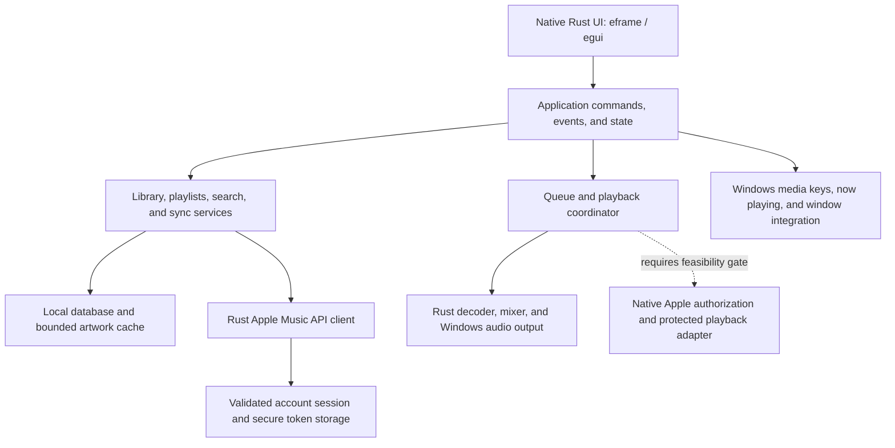

# Cadence: native Rust rebuild plan

Date: 26 October 2026. Status: **proposed; planning only**.

## 1. Goal and interpretation

Rebuild the Windows desktop application and its application backend in Rust, remove the embedded WebView2 login experiment, and reproduce the useful behavior and layout of the original Apple Music application. Full Apple Music functionality remains the target. A local player or preview player is an interim checkpoint, not completion of that target.

The latest instruction supersedes the older `PRODUCT.md`/`PLAN.md` statement that backend choice is flexible. Those historical documents have been preserved during this planning step. Implementation should reconcile them with the selected architecture.

“Backend” means our catalog client, authorization integration, library synchronization, persistence, queue, playback coordination, audio processing, and Windows integration. It does not mean replacing Apple's hosted catalog, subscription service, CDN, or authorization infrastructure. Rust application code will still call operating-system APIs and use dependencies; that is different from claiming every component in the system is implemented in Rust.

**Hard constraints:** no embedded WebView2, hidden browser player, Electron, Tauri web shell, or JavaScript authentication workaround in the proposed application. No fabricated account state, substituted search result for a library song, or preview presented as a full song.

## 2. What was inspected

Claim labels used here: **verified** = inspected or tested in this session; **historical** = recorded by an earlier local investigation; **needs-confirmation** = unresolved; **recommendation-not-fact** = proposed design.

| Area | Evidence and implication |
|---|---|
| Current application — verified | `Cargo.toml` uses Rust 2024, eframe/egui 0.37, Windows MediaPlayer, blocking reqwest, wry 0.55, and raw-window-handle. Most application behavior lives in the 1,743-line `src/main.rs`. This is already a Rust application with an embedded browser login experiment. |
| Login disconnect — verified | `src/auth.rs` opens `music.apple.com/login`, polls MusicKit's website authorization boolean, and reports it through IPC. `main.rs` writes it to `web_login_verified`; it never supplies a Music User Token to the native API or a subscription playback engine. |
| Separate account state — verified | `App::new` clears `store.user_token` and `store.user_email`. Cloud operations depend on `user_token`, while login updates a different boolean. The current login path cannot enable those cloud operations. |
| Playback — verified from source | `src/player.rs` accepts local files and allowlisted Apple preview URLs. `App::start` rejects `resolve:catalog:*`. This is not a protected Apple Music streaming implementation. Live audio was not retested in this session. |
| Persistence — verified | `store.rs` mixes local favorites/history with cloud caches and legacy auth fields. New JSON writes omit tokens/email, but legacy fields can still be read. Saving copies a temporary file over the destination; transactional persistence should replace this. |
| Work scheduling — verified | Worker threads handle most HTTP work, but chart artwork fetching is also called from the UI update handler. Image decoding runs there too. The texture cache clears wholesale after its count threshold. These are concrete responsiveness/cleanup targets. |
| Original installed application — verified | Installed package version `1.1540.23042.0`. Its manifest lists AppleMusic, AMPLibraryAgent, SharedHelper, and appdefaults executables. Installed files include AMP service/UI modules, AuthKitWin, and CoreMedia. File presence does not establish a reusable public SDK. |
| Original interface — verified, limited | Inspected the top transport bar and collapsed/expanded sidebar: Search, Home, New, Radio, Library, Pins, Recently Added, Artists, Albums, Songs, and Playlists. Home displayed “An unknown error has occurred”; its content and playback could not be verified from that screen. Settings and full playback flows were not exercised in this session. |
| Native integration experiments — historical | `evidence/native-feasibility/RESULTS.md` records DLL loading, factories, and Player object construction, followed by failed app-context initialization. A separate package failed with `0xC0000602`; unpackaged startup failed with `0x80073D54`. These experiments were not rerun. |
| Research guard — verified from source | `native-backend-lab/src/main.rs` rejects context initialization in its default build. The historical report identifies preference-migration paths; further initialization research requires an isolated disposable environment. |
| Baseline tests — verified | `cargo test --offline --locked`: 8 passed, 0 failed, 1 ignored live Apple service test. Existing tests cover parsing, URL restrictions, serialization, and formatting; they do not prove account login, audio output, or subscription playback. |

Git baseline: `codex/native-music-prototype`, no commits, no configured remote, and existing project files are untracked. Git diff alone cannot protect this baseline. No commit, push, PR, or merge was performed.

## 3. Feasibility decision before a full rewrite

Apple documents MusicKit playback integrations for Apple platforms, Android, and the web. The reviewed documentation does not provide a native Windows/Rust equivalent. Apple Music API provides catalog and personalized-data operations; subscriber-specific requests require a Music User Token. Neither a developer token nor metadata access establishes a native protected-playback implementation. [MusicKit](https://developer.apple.com/musickit/), [Apple Music API](https://developer.apple.com/documentation/applemusicapi), [user authentication](https://developer.apple.com/documentation/applemusicapi/user-authentication-for-musickit).

This is an unresolved feasibility constraint, not proof that every possible native integration is impossible.

| Approach | Assessment |
|---|---|
| Rust UI + Rust services + documented native authorization/playback integration | Desired architecture, but no suitable documented Windows integration was established. Must pass the gate below. |
| Rust loading Apple's private Windows binaries | Existing research only. Rust bindings still execute proprietary native code, so this would not be a complete Rust backend rewrite. Startup, supported usage, distribution, stability, and update compatibility remain unresolved. Keep outside production. |
| MusicKit JS in WebView2 or an external/hidden browser player | Conflicts with the requested architecture. Excluded from this plan. An external browser sign-in alone would not establish a native playback path. |
| Rust local-file/preview engine | Feasible independent foundation, but insufficient to complete an Apple Music replacement. Do not silently redefine the project around this subset. |

**Feasibility gate:** identify a usable native integration contract, then demonstrate authorized user sign-in, real cloud-library retrieval, and a full subscription track playing past its preview interval through completion, with seek, pause/resume, track transition, and restart/session restoration. Include cancellation, denied access, expired authorization, and sign-out. A website session flag, DLL factory, Player object, or successful HTTP metadata request fails this gate.

If the gate fails, deliver a precise feasibility finding and keep the full-client milestone unresolved. Do not invest in all subscription-dependent screens under an assumed solution. Independent cleanup and Rust-core work can still proceed as explicitly incomplete checkpoints.

## 4. Proposed architecture

**Recommendation-not-fact:** keep eframe/egui for the native UI initially. It already exists, is written in Rust, and supports native rendering without requiring a browser. Rebuilding the application structure and widgets does not require replacing this dependency first. Validate a representative polished screen, keyboard access, text rendering, and scaling before committing to all screens. [eframe documentation](https://docs.rs/eframe/latest/eframe/).



Use a local backend library, not a localhost HTTP server or cloud microservices. Only add a separate backend process when crash isolation is required by a proven provider integration. Commands and typed events connect UI and services.

Proposed layout (introduce gradually, without a crate for every screen):

```text
apps/cadence/                 native window, screens, components, startup
crates/cadence-core/          models, commands/events, queue, capabilities
crates/cadence-services/      catalog, account, library sync, persistence/cache
crates/cadence-audio/         decode, buffering, mixer, DSP, output
crates/cadence-windows/       media controls, secure storage, OS adapters
research/native-backend-lab/  isolated optional research, never a release dependency
docs/                        decisions, capability matrix, verification
```

Key contracts:

- `TrackId` includes its namespace: local file, Apple catalog, or Apple library. Preserve library-to-catalog relationships explicitly.
- `MediaSource` distinguishes `LocalFile`, `PreviewUrl`, and `AppleCatalogItem`; replace overloaded strings and `resolve:*` conventions. Catalog duration and playable preview duration are separate values.
- `AccountState` distinguishes unavailable, signed out, authorizing, authorized, expired, and failed. Only validated native-provider events create an authorized session. Browser booleans and cached email never qualify.
- `PlaybackBackend` exposes capabilities, load/play/pause/seek/stop, state changes, completion, and errors. Unsupported capabilities return typed errors. Protected playback remains separate from local decoding.
- One queue coordinator owns current item, upcoming/history, shuffle, repeat-one/all, and transition decisions. Backend events carry a playback generation so stale end/error events cannot advance a new queue.
- API/sync results carry request and account generations. Cancellation or sign-out invalidates old responses. Use bounded work queues and a shared HTTP client; never perform HTTP, image decoding, or disk scans on the UI/audio callback.
- Store local items/playlists/settings separately from account-scoped cloud caches. Use SQLite transactions via a Rust API as the proposed persistence choice; SQLite itself is an external dependency, not a claim of a pure-Rust database engine. Use OS-backed secret storage for authorized tokens; keep secrets out of library files and logs.
- Retry transient reads with bounded backoff and rate-limit handling. Classify expired auth, subscription/access denial, unavailable content, missing files, offline mode, and output-device failure. Do not blindly retry cloud mutations or replace failures with unrelated music.

## 5. Implementation sequence and completion checks

### Phase 1 — preserve the baseline and remove the broken experiment

Before edits, create a private, recoverable source snapshot and manifest/hash inventory because there is no Git commit. Inventory user data paths without dumping contents. Keep developer tokens, old profiles, and backups out of version control.

| File/area | Planned action |
|---|---|
| `src/auth.rs` | Remove the WebView login implementation, injected JavaScript, IPC, popup management, and browser profile creation. |
| `src/main.rs` | Remove `mod auth`, `LoginWindow`, modal/session-test state, `render_login_screen`, login CLI flags/probes, and all buttons that lead to the disconnected login. Keep an honest unavailable-account state until a provider exists. |
| `Cargo.toml` / `Cargo.lock` | Remove direct `wry` and login-only dependencies, then regenerate the lockfile. Remove direct `raw-window-handle` only if unused; it can legitimately remain transitively through the native GUI. Verify the active Windows dependency graph no longer contains WebView2/wry. |
| `src/store.rs` | Replace legacy auth fields with a versioned migration model. Preserve favorites, imported files, history, and settings. Never treat cached cloud content as a live signed-in account. |
| `src/apple_api.rs` | Preserve reusable API parsing/pagination protections. Separate metadata operations from authorization and playback; move behind a client/session interface. |
| `src/player.rs` / `src/catalog.rs` | Preserve as a regression reference during extraction. Keep preview labeling and source restrictions until the new typed source model replaces them. |
| `native-backend-lab/` / `evidence/` | Preserve the experiments and historical findings separately; exclude them and staged Apple binaries from production packaging. Moving to `research/` is optional and requires updating documented paths. |
| `dist/` | Inventory and archive the obsolete embedded-player output outside the shipping path. Produce a fresh native package only after verification. Do not confuse an old executable with the new source. |
| Existing documentation | Update current-state documents after cleanup; retain historical evidence as historical. |

Do not uninstall the shared system WebView2 runtime, change Apple's installation, or broadly delete profiles/build trees. Removing a dependency from this app does not require system-wide removal. Any Cadence-only profile cleanup must use its verified exact path and remain recoverable.

**Exit:** builds and tests pass; existing local data survives migration; no browser-login entry point remains; the release dependency graph/package is free of embedded browser components; launching the app produces no Cadence WebView child process. Local/preview smoke checks are labeled as such.

### Phase 2 — settle native account and subscription playback feasibility

Create a feature-to-provider matrix for login, library, full audio, lyrics, recommendations, radio, downloads, lossless, Atmos, and video. Record whether support is documented, observed, or unknown.

Investigate supported native provider contracts first. If further private-binary research is justified, use a disposable Windows environment with separate application data and keep the existing initialization guard. Merely setting `isolated-context` is not isolation. Do not patch protected routines or treat copied DLLs as a redistributable SDK.

Run the feasibility gate in section 3. Record exact version, dependency/process set, results, and failure boundary. End this phase with a backend decision and evidence, or an explicit unresolved result. No full-client implementation promise follows a failed gate.

### Phase 3 — rebuild the Rust core and local services

Extract typed models, queue logic, provider interfaces, errors, and commands from `main.rs`. Introduce a bounded asynchronous executor for API/cache work, background image decoding with incremental texture uploads, and a byte-bounded LRU cache instead of clearing all artwork at once.

Implement transactional library storage with schema versions and a reversible import from `library.json`. Keep the original untouched until validation completes. Detect duplicates and missing local paths; retain useful metadata. Account changes partition/invalidate cloud caches.

**Exit:** migration fixtures preserve user data; queue tests cover end-of-track races, shuffle/repeat, removals, and interrupted loads; API fixtures cover pagination, 401/403/429, cancellation, and stale-account responses; no blocking work runs on the UI thread.

### Phase 4 — implement audio and verified Apple services

For unprotected audio, evaluate Symphonia for decoding and CPAL/WASAPI for output, with explicit codec features and a format corpus. Use preallocated buffers, a decode worker, and an audio callback without blocking I/O or allocations. Keep the existing Windows player until the replacement passes equivalent playback checks. [Symphonia](https://docs.rs/symphonia/latest/symphonia/), [CPAL](https://docs.rs/cpal/latest/cpal/).

Implement seeking, accurate timing, device loss/recovery, buffering, and queue transitions before crossfade and normalization. Test gapless support per codec/container: the reviewed Symphonia documentation does not claim gapless support for every format. Local ALAC decoding does not grant access to protected Apple subscription media.

If Phase 2 succeeds, implement genuine session persistence, storefront selection, catalog browsing, cloud library/playlist operations, and subscription playback through the proven provider. Confirm each cloud write from the service response and refresh; do not show success based only on a button click.

**Exit:** real audio fixture checks, physical output-device checks, and authorized Apple-account checks pass independently. Record which paths use Rust decoding versus external provider components.

### Phase 5 — rebuild the complete desktop experience

Match the original app's desktop structure: collapsible left navigation, persistent top transport, central library/browse content, and contextual queue/lyrics panel. Use restrained red accents, coherent typography, real artwork, dense readable track lists, and explicit loading/error states.

Deliver screens in this order: shell and player; local Library/Songs/Albums/Artists and playlist detail; catalog Search and album/artist detail; account-backed Home/New/Radio/library/playlists; queue, lyrics, MiniPlayer, and settings. Subscription screens depend on the verified provider. Never use charts as a substitute for personalized Home or a user's library.

Add keyboard navigation, named accessible controls, context menus, virtualized long lists, DPI scaling, resize behavior, light/dark themes, Unicode font coverage, and Windows media keys/now-playing integration. Validate real window sizes and 100/150/200% scaling; preserve a usable collapsed sidebar.

**Exit:** representative populated, empty, offline, expired-session, and failed-playback screens work. Playback state is shared between main window and MiniPlayer, and every visible control has a working or explicitly unavailable capability.

### Phase 6 — advanced parity, packaging, and performance

The following remain explicit parity targets, not silently dropped features:

| Capability | Required proof |
|---|---|
| Crossfade | Measured transition overlap and duration; correct interaction with queue, repeat, and gapless albums. |
| Sound Check / Sound Enhancer | Verify provider behavior or document a separately named Rust implementation. Custom normalization/EQ is not automatically Apple's exact processing. |
| Lossless / Hi-Res | Verify delivered source format, decode path, output-device format, and actual playback. A preference or catalog badge proves neither output quality nor bit-perfect playback. |
| Dolby Atmos | Demonstrate supported content and an actual compatible rendering path; a stereo effect is insufficient. |
| Offline downloads | A supported authorized download/license lifecycle and actual offline replay, including expiry/removal behavior. Preview caching is insufficient. |
| Music video and quality controls | Confirm provider support and real video/audio synchronization at selected quality. Audio decoding libraries alone do not implement this. |
| Lyrics, recommendations, radio, advanced playlists | Confirm provider coverage and data rights/availability for each; do not assume native-app features all exist in the public API. |

Apple documents Windows lossless/Hi-Res playback and Dolby Atmos; those native-app capabilities do not establish availability to this client. [Lossless](https://support.apple.com/en-nz/guide/music-windows/mus90b573cbb/windows), [Dolby Atmos](https://support.apple.com/en-nz/guide/music-windows/musf7d98bef8/windows).

Package from a clean release output and test on a clean Windows environment. Run formatting, targeted tests, Clippy, and a release build; test startup, suspend/resume, repeated play/seek/skip, device changes, library migration, and uninstall/data preservation. Keep native research out of the installer.

Compare cold start, idle, browsing, continuous playback, and MiniPlayer with the original app using equivalent content, quality, devices, and warm-up periods. Record total process-tree working set/private memory, CPU, GPU, and responsiveness. No RAM/CPU savings claim before equivalent behavior works. Select numeric budgets from measured baselines rather than inventing a savings percentage.

**Exit:** a release evidence sheet lists supported and unresolved capabilities, test environment, total resource measurements, branch/commit/package hash, and publication state. Full replacement is complete only when agreed capabilities actually work; an interim native release must say what remains unresolved.

## 6. Immediate next scope

Implement Phase 1 as one reversible change, verify it, then resolve Phase 2 before the larger subscription-dependent rebuild. Keep the independent Rust foundation moving only with its incomplete scope clearly stated. This planning step changed no application code, login implementation, dependencies, or user data; it added this document only.
